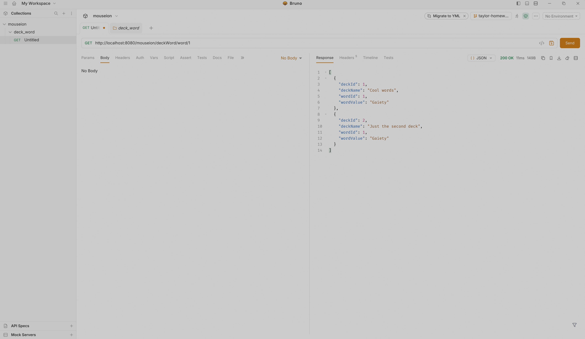
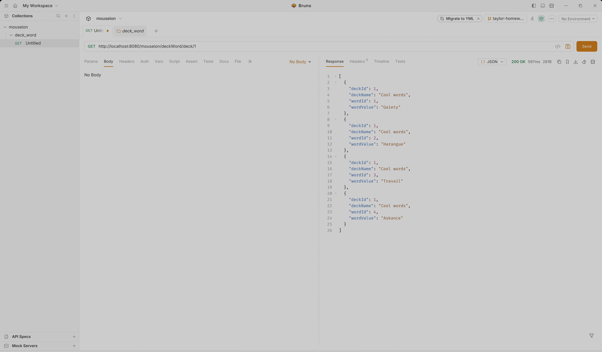
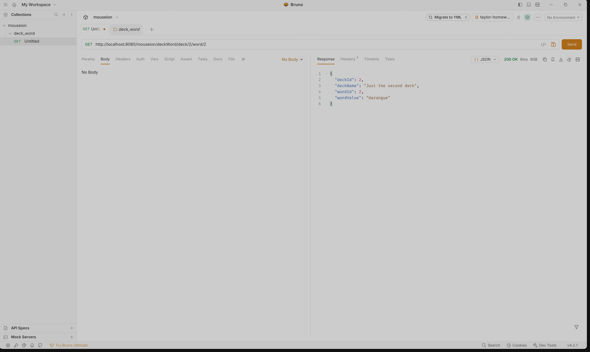
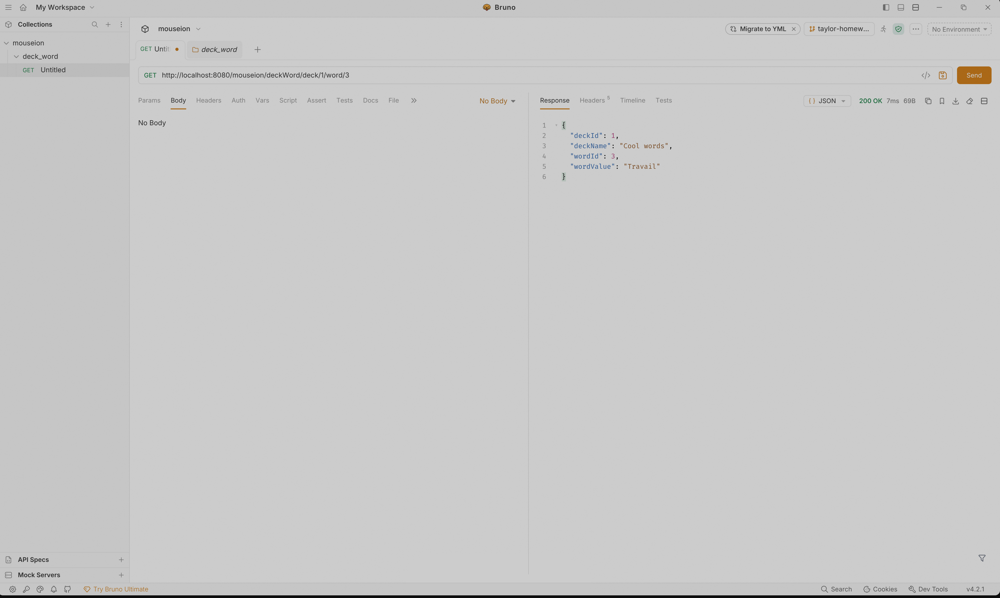

## Get All Decks That Contain Given Word

## Get All Words in Deck

## Get the specific word from the specific deck (Returns the association or composite key relationship)

**Note:** The above image uses an additional deck with an id of 2 that I created to test this request. That additional deck is not in the `init.sql` so that image cannot be replicated out of the box.
