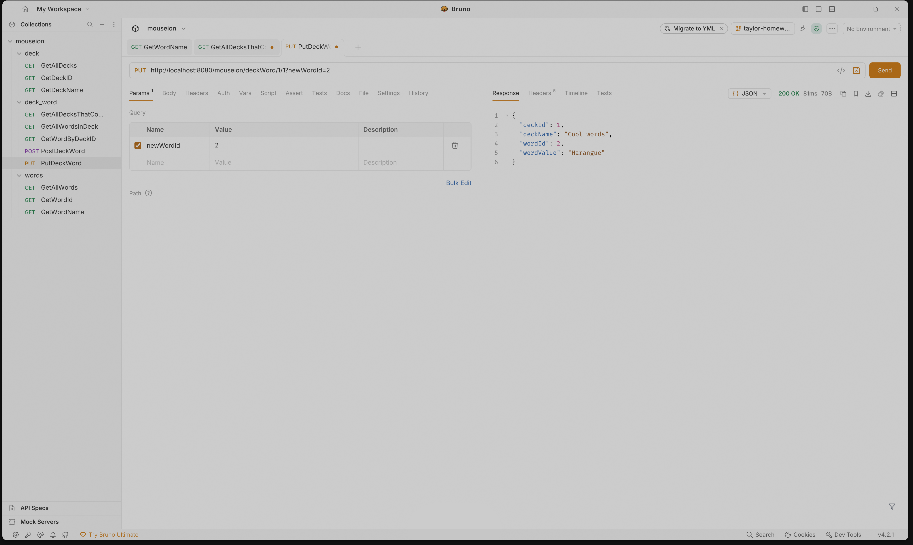
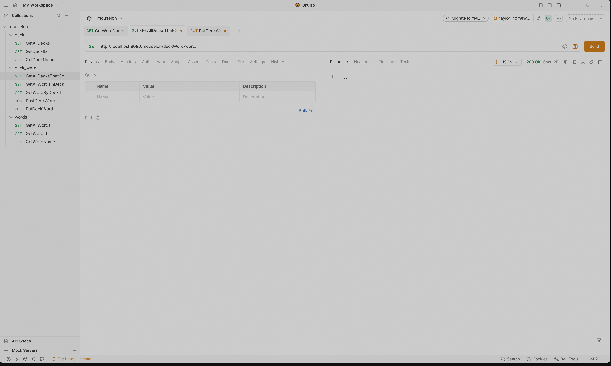

## POST Request

**Note:** I added a new word to the words table in dbeaver to test this behavior.

### Before the POST request

### After the POST request

## PUT Request

### Before the PUT request

### After the PUT request
